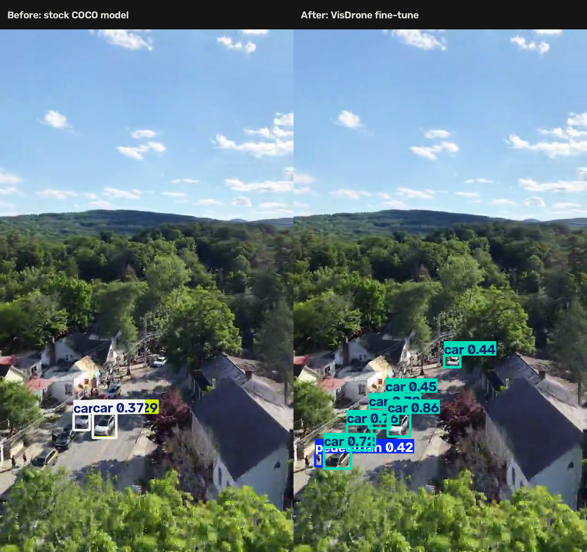
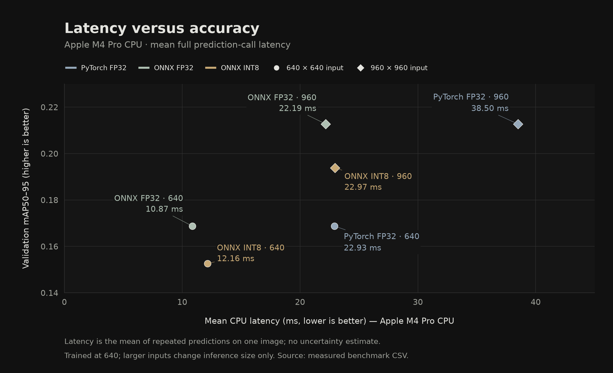
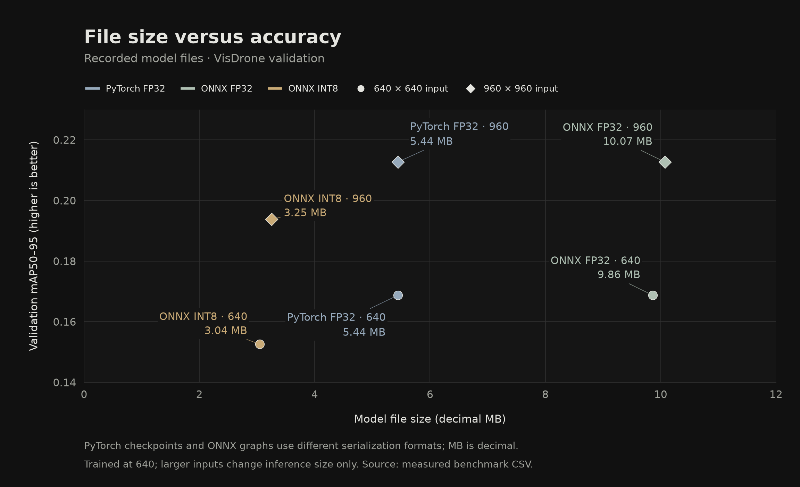

# Aerial Edge Benchmark

An aerial object-detection study comparing inference speed, accuracy, model size and detection-message payloads on an Apple M4 Pro CPU.

**ONNX FP32 at 960 × 960 achieved 0.213 validation mAP50–95 at 22.2 ms mean prediction latency, compared with 0.169 at 22.9 ms for PyTorch FP32 at 640 × 640.** The larger input improved accuracy while keeping the observed mean latency close to the smaller PyTorch configuration on this machine.

[Results](docs/measurements/benchmarks.csv) · [Methodology](docs/METHODOLOGY.md) · [Reproduce](docs/REPRODUCE.md) · [Decisions](DECISIONS.md)

Stock COCO weights (left) and the fine-tuned VisDrone checkpoint (right) on the same [source frame](docs/assets/source-frame.jpg). This is a qualitative example; the models use different class vocabularies. Footage: Jordan Koschei / ConnectHV, CC0. See [source details](data/SOURCES.md).

## Experiment

The study compares PyTorch FP32, ONNX FP32 and calibrated ONNX INT8 at two input sizes. All six configurations use the same YOLO26 nano checkpoint, fine-tuned on VisDrone for 50 epochs at image size 640, batch 16 and seed 0. Training used MPS; validation and timing used the Apple M4 Pro CPU. The 960 configurations change inference size only.

The experiment also compares the payload needed to send detection messages with two video baselines. The laptop provides a controlled place to compare options before testing an intended deployment device.

## Results

Accuracy uses all 548 VisDrone validation images. Timing uses 100 predictions of one saved validation image after 10 warm-up calls, with 8 model intra-op threads. It includes preprocessing, inference, postprocessing and the common configuration/shape checks; image-file loading, warm-up and console logging are excluded.

| Format | Actual input H × W | mAP50–95 | mAP50 | Pedestrian AP50–95 | Mean ms (Apple M4 Pro CPU) | p95 ms (Apple M4 Pro CPU) | File MB |
|---|---:|---:|---:|---:|---:|---:|---:|
| PyTorch FP32 | 640 × 640 | 0.169 | 0.308 | 0.137 | 22.9 | 24.6 | 5.444 |
| ONNX FP32 | 640 × 640 | 0.169 | 0.308 | 0.137 | 10.9 | 11.6 | 9.861 |
| ONNX INT8 | 640 × 640 | 0.153 | 0.287 | 0.119 | 12.2 | 13.2 | 3.045 |
| PyTorch FP32 | 960 × 960 | 0.213 | 0.375 | 0.199 | 38.5 | 39.1 | 5.444 |
| ONNX FP32 | 960 × 960 | 0.213 | 0.375 | 0.199 | 22.2 | 25.4 | 10.071 |
| ONNX INT8 | 960 × 960 | 0.194 | 0.348 | 0.171 | 23.0 | 23.9 | 3.255 |

AP values are fractions; higher is better. Latency is the full prediction call; lower is better. File sizes use decimal MB. Runtime comparisons use matching input shapes within each size group, with guards that stop a run if the shapes differ.

## Speed versus accuracy

At 640, ONNX FP32 measured 10.9 ms against PyTorch's 22.9 ms, with matching validation accuracy to the reported precision. The lower latency made room for a larger input: ONNX at 960 improved mAP50–95 from 0.169 to 0.213 while staying close to the mean latency of PyTorch at 640. These are observed timings on this CPU; the comparison does not establish statistical equivalence or equal tail latency.

## File size versus accuracy

At 640, INT8 reduced the ONNX file size by 69.1%, while mAP50–95 fell from 0.169 to 0.153. INT8 was slower than ONNX FP32 in both input-size groups on this CPU. In this experiment, quantization offered a size tradeoff rather than a latency improvement.

The size comparison uses the two ONNX formats. The PyTorch checkpoint has a different storage representation; see the [precision and file-size notes](docs/METHODOLOGY.md#precision-and-file-size).

## Detection-message payloads

The fine-tuned PyTorch model processed 353 frames from a 640 × 1138 preview clip. Payload rates use the clip's recorded 24 frames/s. The comparison includes the original compressed MP4 and independently encoded JPEG frames at OpenCV's default quality of 95.

| Payload | Average bytes/frame | Average kB/s | Baseline ÷ detection payload |
|---|---:|---:|---:|
| Detection messages | 166.5 | 4.0 | — |
| Average MP4 file bytes per second | — | 63.3 | 15.8× |
| JPEG-frame payload bandwidth | 219896.0 | 5,277.5 | 1320.8× |

Detection messages contain classes, confidence scores and pixel-coordinate boxes. These rates describe payload size for one clip, exclude transport overhead, and do not measure network traffic or processing throughput. There were 78 empty messages; smaller payloads can reflect missed objects. The demo clip's detection accuracy was not measured.

See the [payload methodology](docs/METHODOLOGY.md#payload-calculations) and [saved measurements](docs/measurements/summary.json) for the calculations and underlying values.

## Scope and next steps

This is a laptop benchmark. Target-device latency, sustained heat, power and memory use, and an actual camera/radio pipeline remain unmeasured. Accuracy uses Ultralytics on converted VisDrone labels; it is not an official challenge score. The repeated-image timings do not establish performance across varied scenes or a complete video pipeline.

The [methodology](docs/METHODOLOGY.md) records the thread behavior, NMS mode, percentile convention and other measurement details. Follow-up experiments include NMS-free inference, training at the larger image size, trying a larger model, and testing the intended runtime, camera and link on target hardware. The [decisions log](DECISIONS.md) explains the choices and follow-ups.

## Development

I developed the experiment plan with Claude, wrote the timing loop from a proposed skeleton with review, and wrote the original bandwidth comparison math and decisions log.

Claude supplied the bandwidth frame loop and message format. Codex implemented the training, export, validation and reporting pipeline, supporting wrappers, the MP4 comparison, tests, charts and documentation.

## Licensing

This repository's code is licensed under the GNU Affero General Public License v3.0 (AGPL-3.0); see [LICENSE](LICENSE).

Ultralytics is also distributed under [AGPL-3.0](https://github.com/ultralytics/ultralytics/blob/main/LICENSE) and offers a separate [Enterprise License](https://www.ultralytics.com/license). The repository's code license does not change the separate dataset and footage terms below.

VisDrone is a research dataset. As recorded in [data/SOURCES.md](data/SOURCES.md), the linked upstream README did not include a standalone license grant. Dataset images, annotations and model weights are not included in this repository. Review the upstream terms before reuse or redistribution.

The separate ConnectHV demo footage is CC0, as documented in [data/SOURCES.md](data/SOURCES.md). That statement does not apply to VisDrone.
